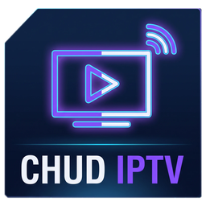
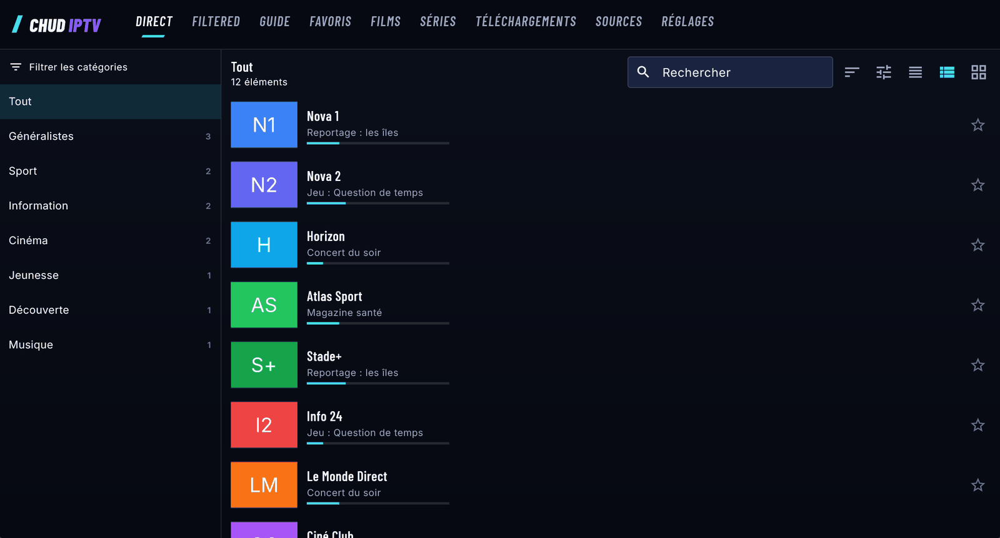
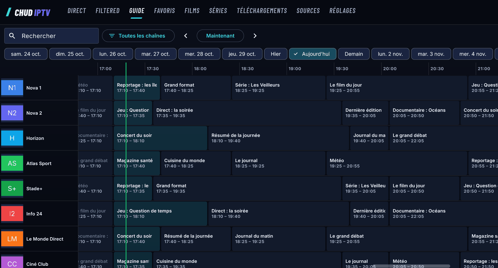
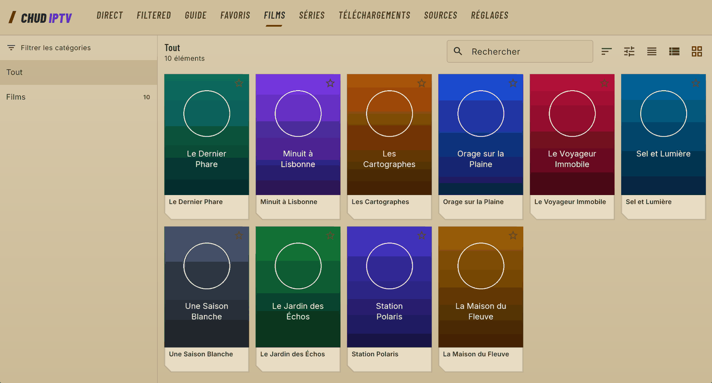
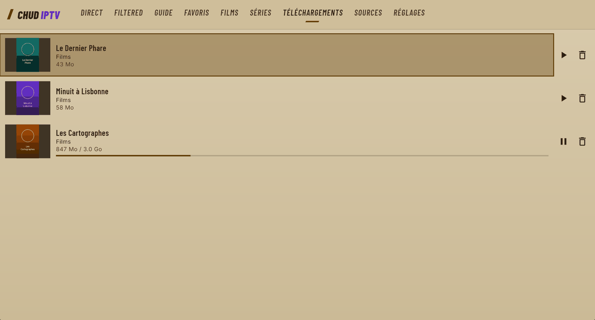

# Chud IPTV

**Un lecteur IPTV simple, rapide et privé pour vos propres playlists.**

Vos sources, vos favoris et vos données restent sur votre appareil. 
Pas de compte, pas de serveur, pas de télémétrie.

### [⬇ Télécharger la dernière version](https://github.com/BigFatDeuce/Chud-IPTV/releases/latest)

[English below](#english)

 

> [!IMPORTANT]
> Chud IPTV est un lecteur : **il ne fournit aucune chaîne, aucun film et aucun abonnement.** Il faut votre propre playlist M3U ou
> votre propre compte Xtream Codes. Les chaînes, films et affiches visibles sur cette page sont fictifs.

## Ce que fait l'app

|     |     |
| --- | --- |
| 📺 **Direct, films et séries** | Importe vos playlists M3U/M3U8, depuis une adresse ou un fichier, et vos comptes Xtream Codes. Les catalogues de plusieurs centaines de milliers de titres restent fluides. |
| 🗓️ **Guide TV et replay** | Grille des programmes XMLTV, programme en cours dans les listes, et lecture des émissions passées quand votre fournisseur le permet. |
| ⬇️ **Téléchargements** | Gardez un film, un épisode ou une saison pour les regarder sans connexion, dans le dossier de votre choix. Le téléchargement reprend tout seul après une coupure. |
| 🔁 **Lecture qui tient bon** | Une micro-coupure ? Le flux se reconnecte seul et le plein écran reste en place. |
| 🔎 **Recherche instantanée** | Tolère les accents et les fautes de frappe, avec tri et filtres par pays. |
| ⭐ **Favoris à votre façon** | Autant de listes que vous voulez, avec leur nom, leur icône et leur ordre. |
| ✨ **FILTERED** | Range automatiquement les centaines de groupes de votre fournisseur par région, pays et thème. Vos playlists ne sont jamais modifiées. |
| 💾 **Sauvegarde** | Exportez vos réglages et favoris. Les mots de passe ne sortent que dans un fichier chiffré par votre phrase de passe. |
| 🔒 **Mises à jour signées** | L'app vérifie la signature et l'empreinte de chaque version avant de l'installer. |
| 🌍 **10 langues** | Français, English, Español, Português, Deutsch, Italiano, Русский, Türkçe, Bahasa Indonesia, Tiếng Việt. |

## Aperçu

<table>
  <tr>
    <td width="50%"></td>
    <td width="50%"></td>
  </tr>
  <tr>
    <td align="center"><b>Le guide TV</b>, jour par jour</td>
    <td align="center"><b>Thème clair</b> ou sombre, au choix</td>
  </tr>
  <tr>
    <td colspan="2"></td>
  </tr>
  <tr>
    <td colspan="2" align="center"><b>Les téléchargements</b>, à regarder sans connexion</td>
  </tr>
</table>

## Installation

Tous les fichiers sont sur la [page des versions](https://github.com/BigFatDeuce/Chud-IPTV/releases/latest).

| Appareil | Fichier à prendre | Comment faire |
| --- | --- | --- |
| **Windows** 64 bits | `…-windows-x64-setup.exe` | Lancez-le. Aucun droit administrateur n'est nécessaire. |
| **Windows** sans installation | `…-windows-x64.zip` | Décompressez, puis lancez `Chud IPTV.exe`. |
| **Android** récent | `…-arm64.apk` | Ouvrez le fichier et autorisez l'installation depuis cette source. |
| **Android** ancien | `…-armv7.apk` | Si la version `arm64` refuse de s'installer. |
| **Linux** | `…-x86_64.AppImage` | `chmod +x Chud-IPTV-*.AppImage`, puis lancez-la. |

> [!NOTE]
> L'app n'est pas signée par un certificat Windows payant : SmartScreen peut afficher un avertissement au premier lancement.
> Cliquez sur **Informations complémentaires**, puis **Exécuter quand même**.

## Premiers pas

1. Ouvrez l'app et choisissez **Ajouter une source**.
2. Entrez votre compte Xtream Codes, l'adresse de votre playlist, ou choisissez un fichier M3U.
3. Laissez l'import se terminer, c'est tout. Films et séries peuvent être désactivés pour un chargement plus léger.

## Vie privée

- Aucun compte, aucune publicité, aucune statistique d'usage.
- L'app ne contacte que vos sources, les adresses de logos et de guides de vos playlists, et GitHub pour chercher une mise à
  jour. Cette dernière vérification peut être coupée dans les réglages.
- Vos données restent sur votre appareil.

## État du projet

La version actuelle est validée sous Windows, sur émulateur Android et sur une Debian 13 vierge. Les essais sur téléphones et
téléviseurs réels sont encore à venir : vos retours sont les bienvenus dans les [issues](https://github.com/BigFatDeuce/Chud-IPTV/issues).

Ce dépôt héberge les versions à installer. Le code source n'y est pas publié.

Chud IPTV ne contourne aucune protection DRM. Vous êtes responsable des contenus auxquels vous accédez avec l'app.

---

## English

**Chud IPTV is a simple, fast and private IPTV player for your own playlists**, on Windows, Linux and Android (phones, tablets and
Android TV). No account, no server, no telemetry: everything stays on your device.

> [!IMPORTANT]
> Chud IPTV is only a player: **it provides no channels, movies or subscription.** You need your own M3U playlist or Xtream Codes
> account. Everything shown on this page is fictional.

- Live TV, movies and series from M3U/M3U8 playlists and Xtream Codes accounts
- XMLTV TV guide, plus catch-up when your provider supports it
- Offline downloads with automatic resume, in the folder of your choice
- Automatic reconnection that keeps you in full screen
- Instant search, multiple favorite lists, automatic group sorting
- Encrypted backups, signed updates, 10 languages, dark and light themes

**[⬇ Download the latest version](https://github.com/BigFatDeuce/Chud-IPTV/releases/latest)**: use the `setup.exe` on Windows, the
`arm64` APK on Android, or the AppImage on Linux. Tested on Windows, an Android emulator and a clean Debian 13; real phones and TVs
are still to come. This repository hosts the releases; the source code is not published here.
